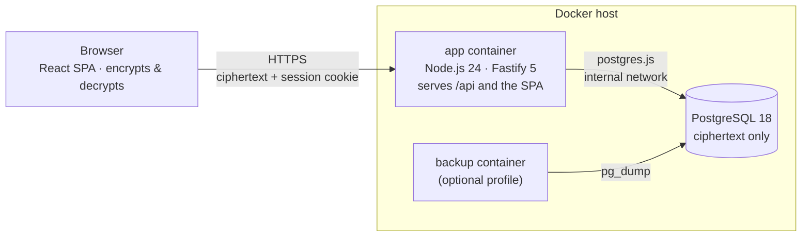
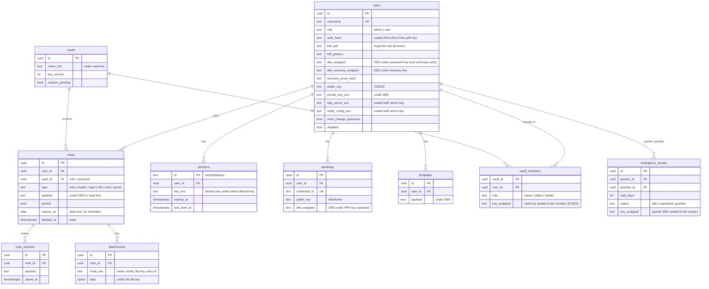

# Architecture

## Overview



One container serves both the REST API (`/api/*`) and the static web app; PostgreSQL is only reachable on an
internal Docker network. **Encryption and decryption happen in the browser** (zero knowledge): the API
stores and returns ciphertext and enforces access rules, it never holds a key that opens content (see
[security.md](security.md)).

## Technology choices

| Area | Choice | Why |
|---|---|---|
| Language | TypeScript (strict) end-to-end | Shared types and validation between API and UI |
| Runtime | Node.js 24 LTS | Built-in crypto for the server layer – no native add-ons |
| Browser crypto | WebCrypto, hash-wasm, @noble/curves | AES-256-GCM/HKDF native, Argon2id as WebAssembly, audited X25519 |
| API | Fastify 5 | Fast, plugin ecosystem for cookies, rate limiting, helmet, static files |
| Validation | Zod 4 (in `packages/shared`) | One schema for API input and UI forms |
| Database | PostgreSQL 18 + Drizzle ORM | Type-safe queries, SQL migrations generated by drizzle-kit |
| UI | React 19, Vite 8, Tailwind CSS 4 | Modern, fast builds, design tokens as CSS variables |
| Data fetching | TanStack Query | Caching, optimistic updates, cache wipe on lock |
| Components | Radix UI primitives, cmdk, sonner, lucide | Accessible dialogs, menus, tabs; command palette; toasts; icons |
| i18n | i18next | German & English, English typed against German |
| Tests | Vitest + PGlite | API integration tests against real Postgres SQL in-process |
| Tooling | Biome, npm workspaces, tsup | One fast linter/formatter, single lockfile, bundled server |

## Repository layout

```
apps/
  server/
    src/
      app.ts            Fastify instance: security headers, CSRF guard, error handler, routes, static files
      index.ts          Entry point: config → DB → migrations → master-key check → listen
      config.ts         Environment parsing (zod)
      crypto/           server layer (master key), login verifiers, session keys
      db/               schema (Drizzle), client (postgres.js or PGlite), migrations in ../drizzle
      plugins/auth.ts   Sessions, requireAuth / requireAdmin guards
      routes/           auth, account, passkeys, notes, attachments, vaults, emergency, templates, stats,
                        transfer (export/import), admin
      cli.ts            Admin command line (master key rotation)
      services/         users, access (roles, vault key versions), notes, vaults,
                        notify (SSRF-guarded), rotation, audit log, maintenance, master-key check
      lib/outbound.ts   Outbound HTTP for notifications (address checks after DNS, no redirects)
    test/               crypto unit tests, API integration tests
  web/
    src/
      pages/            Login/Setup/Recover/Welcome, Dashboard, Notes, Trash, Settings, Admin
      components/       ui/ (design system), layout/ (shell, palette), notes/ (editor, cards), charts/
      hooks/            auth, notes queries/mutations, auto-lock, hotkeys
      i18n/             de.ts + de-features.ts (source of truth), en.ts + en-features.ts
      lib/              API façade (fetch transport + key persistence), WebAuthn (PRF), TOTP, QR scan mapping,
                        password health, theme, formatting
      components/scan/  QR scanner (BarcodeDetector or jsQR, live camera or photo)
packages/
  shared/               Entry types & field definitions, Zod schemas, DTO and wire types, Matter/Wi-Fi helpers
    src/crypto/         Browser crypto: AES-GCM envelopes, HKDF, Argon2id, X25519 ECIES, key hierarchy
    src/client/         Zero-knowledge client (used by the web app and the server's integration tests)
```

## Data model

Columns ending in `_enc`, `_wrapped`, `payload` and `name_enc` hold AES-256-GCM ciphertext created in the browser;
`*_wrapped` keys and the `auth_hash` additionally carry the server-key layer.



`audit_log` (actor, action, target, IP, metadata) and `system` (setup flag, master-key fingerprint) complete the
schema.

## Request flow (reading entries)

1. The SPA calls `GET /api/notes` with the session cookie (and `x-tresor-csrf` on mutating calls).
2. `requireAuth` hashes the cookie token, loads the session + user and checks expiry/idle/disabled.
3. The route returns the rows the user may read (ciphertext + metadata) and the user's sealed vault keys.
4. The browser opens the vault keys with its X25519 private key and decrypts each payload with the DEK or vault
   key (AAD = note id). TanStack Query keeps the result in memory only and clears it on lock or sign-out.

Search, filtering, tags, "recently edited" and the expiry list are computed in the browser on the decrypted list.
The server's statistics use plaintext metadata only (types, timestamps, sizes, audit events).

## Background jobs

An hourly maintenance task removes expired sessions, purges the trash after `TRASH_RETENTION_DAYS`, deletes
audit entries older than `AUDIT_RETENTION_DAYS` and – once a day – sends expiry reminders (counts only) to users
with push notifications.
